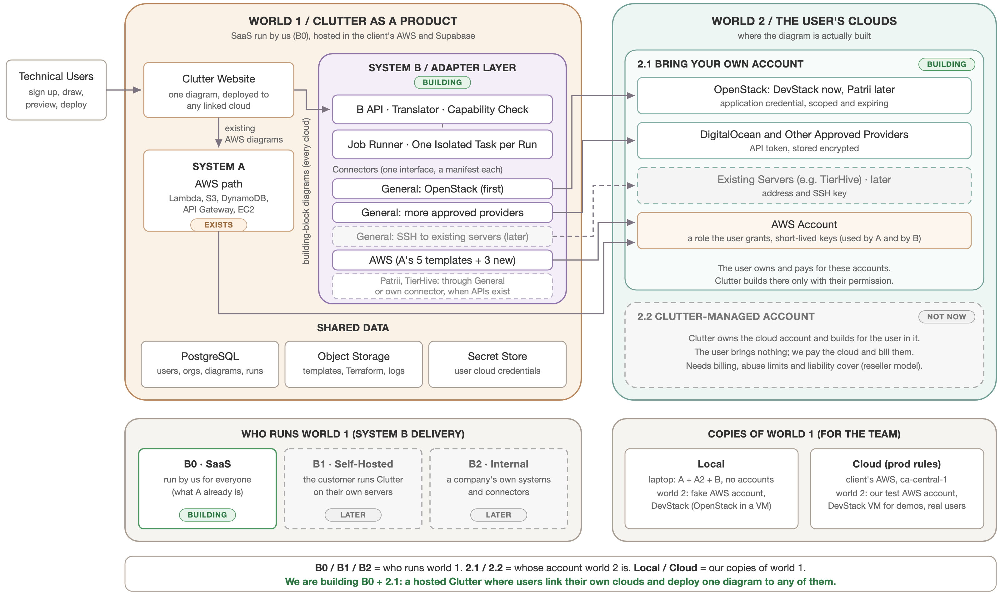

# System B: the adapter layer (planned)

Status: proposed. It follows the team's architecture plan (the figures and write-up in `docs/architecture/system-b-team-plan/`) and the product decisions in ADR-013 to ADR-017: B0 with users' own accounts, one diagram with many deployments, and AWS as a B connector too. Nothing here is built yet; the build order is `implementation-plan.md`. The decisions it rests on are in `docs/decisions.md`; what exists today is `system-a-as-built.md`; the Patrii facts are in `docs/research/patricloud/2026-10-26-patricloud-research.md`.

## The goal

Expand the Clutter codebase so a diagram can deploy to targets other than AWS: General first (one connector per approved Terraform provider, OpenStack first), then AWS as a B connector, then PatriCloud (our working name for Patrii Cloud), TierHive and whatever comes later. There is one standard way for Clutter to talk to any target (the **connector interface**), and one **connector** per target. The people who come after us add connectors without reworking what exists.

**The problem.** People want to describe infrastructure as a picture and have it built for real in their own cloud, without writing Terraform. A does that for AWS only, and AWS is wired through its core: the generator, the canvas, the account link and the deployer. Adding one more cloud to A means rewriting all four.

**The value of the adapter layer.** The core (canvas, translator, capability check, job runner) is written once, and each target is one connector. A new target costs a connector, not a rewrite. For users: one diagram builds on AWS, on Canadian clouds such as Patrii, on cheap VPS hosts, or on the approved Terraform providers. For customers who will not hand their cloud keys to an outside service: they can run Clutter themselves (B1). For later teams: they add targets without touching what works.

**The product, as a user sees it.** Clutter is one hosted product, in the way Brainboard is: a user signs in, links the clouds they already have (an AWS account, an OpenStack project, a hosting provider, their own servers), draws one diagram, and deploys it to any of those clouds, or to several. They never see A, B or a connector; they see one editor, one Connections page and one deploy panel.

The layer has two faces:

- **Outbound:** connectors behind one interface. Adding a target means writing a connector, not editing the core.
- **Inbound:** B's own API, versioned, that Clutter's UI calls and that people and other products can call to use Clutter without learning React Flow, Supabase webhooks or AWS role ARNs.

The inbound half and its standard objects come from a second, independent research run on 2026-10-26 (`docs/research/patricloud/2026-10-26-second-research-run/`), checked against the code by the lead. The outbound half's structure (A, B, connectors, instances) comes from the team's plan.

Clutter owns intent (what the customer wants); targets own resources. Callers talk to Clutter; Clutter talks to targets. A target such as Patrii is not a host for the standard and not a caller: it publishes no inbound plugin and has no diagram, plan or apply resource. A target-side integration that only wants inventory (as Patrii's Lynx DCIM connector sketches) is a read through the same connector.

## Names

This table owns the names. Other docs use them and point here.

| Name | Means |
| --- | --- |
| **C** | the whole Clutter app: A + A2 + B |
| **A** | Clutter as it exists today: the AWS system, complete and tested (`system-a-as-built.md`). It keeps serving existing AWS diagrams. |
| **A2** | the local extension (`backend/devserver`): it runs A without AWS, and runs B beside it on a laptop. It wraps A and does not change it, except the local-only Link fake account button (ADR-011). For the team, not for users. |
| **B** | the adapter layer we are building, beside A (Option 1, ADR-006) |
| **world 1** | Clutter itself: website, APIs, database, object storage, secret store and runners, in an account Clutter's operator controls |
| **world 2** | the cloud accounts where users' diagrams are built. World 1 never builds a user's resources inside itself. |
| **2.1** | world 2 is the user's own cloud accounts, which they link to Clutter. **Chosen; being built.** |
| **2.2** | world 2 is cloud accounts Clutter owns and resells. **Not now** (ADR-013); an optional Clutter sandbox connection may come later. |
| **B0** | B run by us as a hosted service (SaaS), so we run world 1. Built first. |
| **B1** | B shipped as a self-hosted service people run on their own servers, so they run world 1. Its connectors are entity connectors. Later. |
| **B2** | B run inside a company's own setup, with instance connectors. Later; whether to do it at all is a separate decision (ADR-007). |
| **connector** (**X1 … Xn**, or **1 … n** in the figures) | the code for one kind of cloud, behind one interface: General's connectors (§ General) and AWS; later Patrii and TierHive, through General where they offer a standard provider |
| **General** | the team's name for a family of connectors: one per approved Terraform provider (OpenStack first, DigitalOcean next), plus existing servers over SSH (later). Users never see the word; they pick a cloud by name. |
| **entity connector** | a connector for a kind of cloud, written once by us (B0 and B1) |
| **instance connector** | a connector a company builds or configures for its own setup (B2) |
| **connection** (**I1 … In** in the figures) | one organization's linked cloud account: a connector plus credentials and region. Older docs and figures call it an instance. |
| **building blocks** (**a … n** in the figures) | the standard features every connector maps onto: VM, network, firewall, volume, bucket, function, table, HTTP API |
| **project**, **diagram** | as in A: a project holds diagrams. A diagram drawn in building blocks is marked `engine: "blocks"`. |
| **deployment** | one diagram bound to one connection, with its own settings, exclusions, Terraform state and run history. A diagram can have several. |
| **workspace** | not in the first build: a second environment of the same diagram is a second deployment |
| **seam** | one of the places B touches A (§ The seams: where B touches A even in Option 1) |
| **phase 0** | the security fixes on paths A and B share; part of stage 1 (`.claude/findings/NOW.md` § Phase 0) |
| **stage** | one step of the build order, 0 to 8 (`implementation-plan.md`) |
| **local**, **cloud** | our two copies of world 1: a laptop with no accounts, and one cloud environment in `ca-central-1` (ADR-015, `environments.md`) |
| **PatriCloud** | our working name for Patrii Cloud (patrii.cloud), a Canadian cloud; the same thing |

A cloud's own word for its tenant (Patrii and OpenStack call it a project) is never used for a Clutter object in B's code; it is a connector-side field such as `patrii_project_id`.

## Four separate questions

Most confusion about B comes from mixing four questions that have separate answers.

| Question | Choices | Chosen |
| --- | --- | --- |
| Who runs Clutter itself (world 1)? | B0 us, as SaaS · B1 the customer, self-hosted · B2 a company, internally | **B0** (ADR-007) |
| Whose cloud does a diagram build in (world 2)? | 2.1 the user's own accounts · 2.2 accounts Clutter owns and resells | **2.1** (ADR-013) |
| How is B's code related to A's? | Option 1 beside A · Option 2 reuse parts of A · Option 3 turn A into a connector | **Option 1**, reusing A's sign-in, database and templates (ADR-006, ADR-014) |
| Which copy of world 1 is it? | local · cloud | **local and one cloud**, run with prod rules (ADR-015) |

B1 is not 2.2. B1 means a customer runs Clutter on their own servers and builds in their own clouds; 2.2 means Clutter owns the clouds users build in. The user never sees any of these choices.



## Level 1: how B attaches to A

| Option | What it is | Status |
| --- | --- | --- |
| 1. Build B next to A | A stays as it is. B is a new, separate part of the same app, backend services and frontend screens, with its own tests. Connectors plug into B. | **Main priority** (ADR-006) |
| 2. B reuses parts of A | Same structure, but B calls existing A code instead of copying it. `backend/api/generic` (responses, Postgres access, the membership check) and the JWT sign-in are the candidates. | Fallback |
| 3. Turn A into the adapter | Edit A, strip its AWS-only parts, split the Terraform engine, migrate the database. AWS becomes one more connector. | Avoid as a starting move; reachable later, piece by piece |

Why Option 1: A is a working application, and every change to it means retesting every AWS path. Leaving A alone keeps that work safe, and puts all new work and tests in B.

The trade-off of Option 2: once B depends on parts of A, a change there can break B. A shared piece needs its own tests before B calls it.

### The seams: where B touches A even in Option 1

These are unavoidable and named here so that Option 1 does not drift into Option 2 without a decision:

1. **The UI.** A Connections page for every cloud, a palette and forms read from connector manifests, and a deploy panel that lists the diagram's deployments. Existing AWS diagrams keep A's screens and calls; new diagrams call B.
2. **Shared sign-in and the JWT authorizer.** Users sign in once. B verifies A's JWT.
3. **The shared database.** Orgs, projects and diagrams stay A's tables. B adds tables for connections, credential references, deployments and runs. B reads A's linked AWS roles as AWS connections, so a user links an AWS account once.
4. **A's security defects.** B inherits A's sign-in, its database and its membership check, so the defects in `.claude/findings/NOW.md` that sit on those paths are B's defects too. Fixing them is the main change to A's behaviour this plan requires (phase 0); stage 1 also moves A's template loader and JWT check into `generic`, makes the generator read the environment's region, and replaces the Supabase webhook with an authenticated save-then-generate step. The open generation endpoint and the database's row-level security are the two that touch shared paths directly.

Any other change to A is a decision, recorded in `docs/decisions.md` before it is made.

## Level 2: inside B

### B0, B1 or B2

The same B can be delivered three ways. They differ in who runs world 1 (§ Names) and so who holds the users' cloud credentials.

| | B0: SaaS | B1: self-hosted | B2: internal |
| --- | --- | --- | --- |
| World 1 runs | in our cloud, run by us | on the customer's own servers, run by them | inside a company, run by them |
| World 2 builds in | the users' clouds | the customer's clouds | the company's private systems |
| Postgres | ours | theirs (any Postgres) | theirs |
| Object storage | ours | theirs (any S3-compatible: MinIO, Ceph, Patrii's S3) | theirs |
| Secret store and cloud credentials | held by us | held by them | held by them |
| Connectors | ours | ours | ours, plus instance connectors the company writes |
| Good for | most users | companies that will not hand their keys to an outside service | companies with in-house clouds |

Order: B0 first, B1 when a customer asks for it, B2 only with a partner who supplies the details. For B1 and B2 to stay possible, B never assumes AWS S3 or Supabase: it takes any Postgres and any S3-compatible store from day one. A has Supabase-only parts (the `anon` role) that B does not copy; A2's local S3 already shows the S3 code working against a store that is not AWS.

### Standard features, connectors and connections

Each connector declares, per standard feature, how it treats it. This is the capability manifest (ADR-001).

| Treatment | Meaning | Example (an Acme TierHive connection) |
| --- | --- | --- |
| as-is | the feature maps straight across | a: compute VM, b: bucket |
| extended | the feature exists, with more for this connector or connection | c: config runner plus a custom image |
| removed | the feature does not apply | d: no serverless functions |
| new | something only this target or connection has | e: GPU node |

Shared behaviour lives in the standard features. Differences live in the connector or the connection, never in the standard set. The UI hides what a target cannot do instead of failing at deploy time.

The first building blocks, and what each first connector maps them to:

| Building block | AWS connector | OpenStack connector (General) |
| --- | --- | --- |
| VM | EC2 instance (A's template; its AMI is fixed to Amazon Linux 2023 on x86, so image choice is new work) | Nova server, with a floating IP when it must be reachable |
| Network and subnet | new template: VPC, subnet, internet gateway, route table | Neutron network and subnet, and a router whose gateway is the cloud's external network (a connection setting) |
| Firewall rules | new template: security group (A's EC2 template has none) | security group and rules |
| Block volume | new template: EBS volume and attachment | Cinder volume and attachment |
| Bucket | S3 bucket (A's template) | removed (Swift later) |
| Function | Lambda (A's template; its code comes from A's upload layout, see § AWS) | removed |
| Key-value table | DynamoDB (A's template) | removed |
| HTTP API | API Gateway REST API (A's template; it has no Lambda integration yet) | removed |
| Config runner | not in the first cut (A's Ansible is a separate pipeline, not a template) | not in the first cut |

The new AWS templates are B's work in stage 5; A never had them.

Principles carried from the first design:

1. **Capability-based, not lowest common denominator.** A common-denominator model would remove Lambda, API Gateway and DynamoDB from every user to make room for a target that lacks them. A diagram may use any block; a target that lacks one says so before anything runs.
2. **Building blocks first, target-only extras allowed.** A node is a building block ("VM") with common fields (name, size, image) and per-target settings (an AWS instance type, an OpenStack flavor). A target-only node (marked "new" in its manifest, such as a GPU flavor) is allowed, but it limits which targets the diagram can deploy to. This replaces "target-native nodes first" (ADR-014).
3. **One owner per resource definition.** The connector's manifest, in Go, is the single source. B's catalog route, palette and config panel read it; nothing is maintained beside it. (A's five-place drift is not repeated in B.)
4. **B's core never names a connector.** It asks the registry for the deployment's connector and calls the interface. A `switch target` in the core is a defect.
5. **Credentials are the connector's shape, stored B's way.** Each connector declares its credential schema and how to verify it. B stores a reference to an encrypted secret, never the secret in a plain column, and never logs it.
6. **State lives with the target where it allows it.** For Patrii, Terraform state for a customer's deployment belongs in that customer's object storage, with locking, not in Clutter's shared bucket. Where the target has no storage that supports locking, state stays in Clutter's storage, encrypted and locked, keyed by deployment id.

### One diagram, many deployments

A diagram is drawn once. Each place it runs is a **deployment**: the diagram, one connection, that connection's settings, and its own Terraform state and runs (ADR-014).

- **Deploying to several clouds** means deploying each deployment. Each is an independent run; one failing does not undo another.
- **The deploy panel shows a compatibility line per connection,** computed by the capability check: "AWS: ready", "OpenStack: 1 block not supported (Function)". The user either removes the block from the diagram or **leaves it out of that deployment only** (a per-deployment exclusion, shown on the line); a deployment cannot start while an unsupported block is still included.
- **Settings that differ per cloud** live on the deployment, not on the diagram: instance type on AWS, flavor and image on OpenStack, region on both.
- **Edges** between blocks mean the same everywhere they can: a VM attached to a network, a volume to a VM, a function allowed to read a bucket. Each connector turns an edge into its own wiring (an IAM policy on AWS, an attachment on OpenStack). An edge a target cannot express is reported like an unsupported block, and an edge to an excluded block is dropped from that deployment with a note.
- **Names and renames.** Inside the generated Terraform, each block is addressed by its node id, not its name, so renaming a block does not destroy and re-create it. Every cloud-side name (resource names, IAM role names) carries a short deployment prefix, so two deployments, or A and B, can share one cloud account without colliding.
- **What a run deploys.** Each run records the diagram history version it was built from, so the run history says exactly what was deployed, and a later edit does not change what an earlier run claims.
- **Deleting.** A connection with live deployments cannot be deleted until those deployments are destroyed; the same holds for a diagram, project or organization with live deployments. Deleting is a tombstone first, and a clean-up job removes the secret and the state once nothing is live.
- **Tenancy.** Every deployment action checks three things before anything runs: the caller is a member of the organization, the diagram belongs to that organization, and the connection belongs to the same organization.
- **A diagram is A's or B's.** A building-block diagram carries a marker in its saved document (`engine: "blocks"`). A's generation step skips such diagrams, and A's editor never opens them; diagrams without the marker are A's, unchanged.

Later, not in the first build: blocks in one diagram placed on different clouds (an OpenStack VM reading an AWS bucket). Edges across clouds cannot carry permissions, only addresses and keys passed as settings, so this waits until single-cloud deployments work.

## Level 3: how B works

### Parts

| Part | Job |
| --- | --- |
| B API | B's own Go service and routes; the inbound standard (below) |
| Translator | turns the stored diagram into a neutral graph not tied to AWS |
| Capability check | compares the graph with the chosen connector's manifest and flags unsupported pieces before anything runs |
| Job runner | queues the job, tracks status and logs, as A does today |
| Connector interface | the one contract every connector implements |
| Connectors 1 … n | General's (OpenStack first, then more approved providers, then existing servers over SSH), AWS, and future targets (§ General) |
| Shared Postgres and S3 | A's orgs, projects and diagrams, plus B's connection, credential reference, deployment and run tables |

### One deploy through B

1. The user clicks Deploy on one or more of the diagram's deployments (for example Acme's OpenStack).
2. B API sends the diagram to the translator.
3. The translator builds the neutral graph and runs the capability check.
4. The result comes back: OK, or the unsupported pieces.
5. B API queues the job (status QUEUED).
6. The job runner calls the connector: validate, then plan.
7. The connector applies on the target, creating the VM, bucket and so on.
8. The target returns status and resource ids.
9. The connector returns logs and state to the job runner (status COMPLETED).
10. The UI polls for status, as A does today.

### The connector interface (first cut)

The plan's contract is validate, plan, apply, destroy and logs. The capability manifest and credentials need methods too. A first cut, to be settled in stage 3:

```go
// Package connectors. Each target implements Connector and registers itself.
type Connector interface {
    ID() string                                        // "general-openstack", "aws", later "general-digitalocean", "general-ssh"
    Manifest() Manifest                                // blocks (as-is, extended, removed, new), fields, defaults, allowed values
    Credentials() CredentialSpec                       // what a connection supplies, and how the UI asks for it
    VerifyConnection(ctx context.Context, c Connection) error // proves a connection's credentials work before it is saved, and again before each run
    Validate(g Graph, d Deployment) []Problem          // refuses unsupported blocks and bad values before anything runs
    Plan(ctx context.Context, g Graph, d Deployment) (PlanResult, error)
    Apply(ctx context.Context, g Graph, d Deployment) (RunResult, error)
    Destroy(ctx context.Context, d Deployment) (RunResult, error)
    Logs(ctx context.Context, run RunRef) (LogStream, error)
}

// A Deployment carries everything one run needs: its id (which keys the state and the name prefix),
// its connection, its per-deployment settings and exclusions, and its state backend.
```

A workspace (an environment inside a connection) is not in the first build; a second environment of the same diagram is a second deployment.

How a connector does plan and apply is its own business, but most should share one way (ADR-002): render HCL for an existing Terraform provider and hand it to a shared Terraform runner that holds state with a lock. Plan, apply, state and drift then stay in Terraform, as in Terraform's own core and provider split, and Clutter does not create resources through cloud APIs itself. A connector calls a target's API directly only when that target has no Terraform provider and no standard API (see Patrii Path C). Remote configuration (A's Ansible over SSM) is not in the first cut: Patrii and most non-AWS targets have no SSM equivalent, so the config runner feature waits for a choice between cloud-init at boot, SSH through a bastion, or a pull agent.

### Isolating the runner

The runner holds the keys to a user's cloud, so it is built so that a mistake or a hostile diagram reaches only that one run's cloud (ADR-017):

- **One task per run.** Each run starts its own short-lived container with no database access and no secret-store access. A broker in B's API fetches that run's credentials and hands in only those: short-lived session keys for AWS, the one connection's token for others. A's runner, by contrast, can assume every customer's role and is handed the database string (a phase 0 item).
- **Only Clutter writes the Terraform.** B renders HCL from building blocks with its own templates; no user-written HCL reaches the runner. General supports only providers on an allow-list that Clutter maintains, not any provider a user names.
- **Dangerous features are refused.** Rendered Terraform may not contain provisioners or the `external` and `http` data sources; the runner checks this before `plan`. `TF_LOG` is never set, so provider debug output cannot leak credentials into logs.
- **Its own cluster.** B's run tasks do not share a cluster with A's, so A's `logs/live` cannot read them.

What each part replaces in A, for the day AWS moves into B (Option 3, later):

| B part | Replaces in A |
| --- | --- |
| `Manifest` | the type constants, the label switch, the seed rows, the palette list and the config panel option lists |
| `Validate` | per-generator `ValidateVariables`, plus the input validation that is missing today |
| plan and apply through the Terraform runner | the generator files, the template prefix, IAM from edges, the fixed `provider "aws"` block |
| `Credentials`, `VerifyConnection` | the CloudFormation link and role-ARN handlers, which store the ARN unverified |
| connection credentials into the runner | the role ARN and external id passed to the deployer, and the STS step in its script |
| the runner's state backend | the local state file synced to S3 without a lock |
| the region list in the manifest | the region list in `generic`, the schema enum and the frontend's own list |

## The inbound standard: B API

### Principles

1. **Clutter's model is the contract.** Callers send intent; connectors turn it into each target's resources. A caller never sends an ARN, a Terraform block or a target's API path as the standard's vocabulary.
2. **Every caller resolves to a member.** A service credential is a new way to mint an identity that still passes the one membership check (`CheckOrganizationMembershipPSQL`), never a bypass of it. Google sign-in stays one client of the same rule.
3. **Compile and run are one authenticated sequence.** A public webhook that compiles, and a diagram save that does not (as in A), cannot be the contract.
4. **B API is the only versioned surface.** `/v1`, one error envelope, one id style, an idempotency key on every create. Neither A nor Patrii has idempotency today, and Patrii's own changelog records a retried create starting duplicate billable servers.
5. **A's trust boundary is not standardized.** The admin-sized customer role and the open compiler are fixed before any other product is invited in.

### The objects

| Object | What it is | In A today |
| --- | --- | --- |
| Organization | the tenant | organization CRUD; the creator is the only member; no invite route (the frontend members API is a mock) |
| Project | holds diagrams | project CRUD; name column 32 characters while the API schema allows 100 |
| Desired state | the diagram, as a neutral graph the standard translates to and from the canvas document | diagram CRUD; save does not compile |
| Deployment | one diagram bound to one connection, with its settings, exclusions, state and runs | none: a diagram has one implicit AWS deployment |
| Target | a connector type (X), with its manifest | none: AWS is implicit |
| Connection | one organization's configured setup of a target (I1 … In in the figures), with a credential reference and region | the AWS-named role table and its two-step CloudFormation link |
| Run | validate, plan, apply or destroy of one deployment; one resource to poll, events to subscribe to | Terraform runs in `diagram_deployment_logs`, Ansible in `jobs`: two tables, polled logs, no events |
| Catalog | the features a target accepts, read from its manifest | the seed table, the generator switch and the config panel: three lists that drift |

Not in the standard until a handler exists: member invites and roles, token refresh and revoke, and diagram history (A writes it, never exposes it).

### Connecting a target

To build in a user's cloud, Clutter needs that user's permission. A connector's `Credentials` method says what to ask for, and `VerifyConnection` proves it works before anything is saved. There are two kinds:

- **Borrowed access**, the kind A uses for AWS: the user creates a role or identity in their cloud that trusts Clutter, and Clutter asks the cloud for short-lived keys at each run. Nothing permanent is stored; the user revokes access by deleting the role.
- **A stored token or key**, when the cloud offers nothing else: Clutter must keep it.

| Target | The user supplies | Kind |
| --- | --- | --- |
| AWS | a role, through a CloudFormation link (as in A) | borrowed, short-lived |
| Azure, Google Cloud | an identity that trusts Clutter (workload identity federation) | borrowed, short-lived |
| OpenStack, including Patrii if it opens its endpoints | an application credential with an expiry and access rules | scoped token |
| DigitalOcean, TierHive's future API, most hosts | an API token | stored token |
| Existing servers (General's existing-servers connector, later) | an address and an SSH key | stored key |

Rules: prefer borrowed access wherever the target supports it. A stored token goes into a secret store, encrypted, and Postgres keeps only a reference to it. The token reaches the runner for one run only and never reaches a log, a response or a doc. Clutter never asks for a cloud password (ADR-016).

Where a stored token lives: in B0, AWS Secrets Manager in Clutter's account, one secret per connection; locally, A2 encrypts it with a key from its own config. Deleting a connection deletes its secret. The runner reads the token at the start of a run, passes it to Terraform as an environment variable, and drops it when the run ends.

### The Connections page

Linking a cloud is the step most users fail at, so it gets the most care:

- **One page, one tile per kind of cloud.** A connection belongs to the organization, so every diagram and every teammate reuses it.
- **AWS stays one click:** the existing CloudFormation link creates the role. B then checks the role itself (`VerifyConnection`) instead of asking the user to paste an ARN and trusting it.
- **OpenStack accepts what the user already has:** a `clouds.yaml` file or an openrc file, or the fields typed in. The page explains how to create an application credential and asks for one, not a password.
- **Every connection is verified before it is saved,** and the page shows its state: working, failed with the reason, or expiring soon.
- **Errors say what to do next** ("this credential cannot create volumes: add the volume permission"), not a raw cloud error.

### What a connector may and may not do

| May | May not |
| --- | --- |
| say what its target offers (its manifest) | read or write Clutter's Postgres; the core does that |
| check a set of credentials | see any other organization's data |
| plan, apply and destroy in one user's target, with that user's credentials, for one run | keep credentials after the run |
| return logs and results | put a secret in a log or a result |

So a faulty connector can reach only the one target it was handed, for one run.

### Where data lives

World 1 keeps the same kinds of data as in A: users, organizations, projects, diagrams and runs in Postgres; generated files and logs in object storage; credentials in a secret store (for AWS, only a role reference). Terraform state is the exception: it goes to the user's own storage in world 2 when the target has any (Patrii's S3-compatible store, for example), and otherwise to Clutter's storage, encrypted and locked, never as A does today (unlocked, in one US bucket for every user).

What each target can build in world 2 is its manifest. Today's best estimate:

| | AWS | PatriCloud | TierHive | General |
| --- | --- | --- | --- | --- |
| VM | EC2 | VPS | VPS | the provider's |
| Object storage | S3 | S3-compatible | none | depends |
| Block disk | EC2's default disk in A; EBS volumes in B | volumes | part of the VM | depends |
| Database | DynamoDB | managed Postgres, MySQL and others | none | depends |
| Serverless, API front door | Lambda, API Gateway | none | none | depends |
| Network, load balancer, DNS | not offered in A; VPC, subnet and security group in B | yes | private network, HAProxy | depends |

### Where B runs

A's API is many small Lambda functions behind API Gateway: each route starts on demand, and it only runs on AWS. B is one Go service in a container instead, for three reasons. Its main work is Terraform runs that last minutes and need the Terraform binary and its providers (hundreds of megabytes), which do not fit Lambda's limits; A runs those parts in containers too (its Fargate deployer). B1 is a service other people run on their own servers, so B cannot depend on Clutter's own API Gateway and Lambdas. And one service is simpler to run locally. In B0 the container runs on AWS Fargate, the same service A's deployer uses. The default is one Go service in a container that runs anywhere: hosted by us next to A, or self-hosted. The Terraform runner is a second process that sits where it can reach the target and the state; whoever runs it holds the target credentials and the state. Hosting moves custody, not the contract (ADR-004).

## The connectors

### General: many clouds through approved Terraform providers

General is not one cloud. It is a family of connectors that share one kit: one connector per approved Terraform provider, plus one for servers the user already has. It is built first (stage 4), because it needs no partner, and it is how most new clouds arrive later. Its scope is still open with the client (question 1 in `.claude/findings/NOW.md`); this is the default.

- **What the user sees.** The Connections page lists clouds by name: AWS, OpenStack, and more as they are approved (DigitalOcean next, then whatever users ask for), plus "Existing servers". "General" is the team's name for the family, not a word on a screen. The user picks a cloud, fills in its credential form, and gets a connection.
- **One connector per approved provider.** Each registers with its own id (`general-openstack`, later `general-digitalocean`, and so on) and has its own manifest, credential spec and verification call, because each provider builds different things and signs in differently. They share General's kit: the HCL renderer and escaping, the provider allow-list and version pins, a tool that turns a provider's schema (`terraform providers schema -json`: required, optional and sensitive fields) into a draft manifest, and the shared Terraform runner.
- **Existing servers** (`general-ssh`): the connection is a list of hosts the user already has, reached over SSH (through a bastion where needed), and the config runner runs Ansible against them. This is how a TierHive or Patrii server created by hand is used before those clouds have an API. It waits for the config runner (§ The connector interface), so it comes after the first build.
- **Why an allow-list, not any provider.** A provider is code that runs with the user's credentials inside Clutter's runner (§ Isolating the runner), so a user cannot name an arbitrary one.
- **Adding a provider later** is a new General connector, not a change to B's core: pin the provider's version; choose the resources to support and map them to building blocks in the manifest; write the credential spec and verification call; pass the shared contract tests against a test account or a local emulator; then add it to the allow-list. Big providers have hundreds of resources, and turning a raw schema into a usable canvas is the hard part, so each starts with a small chosen set. A comparable product, Brainboard, already turns diagrams into Terraform for a fixed set of large clouds.
- **When a cloud gets its own named connector instead.** Only when no approved Terraform provider can reach it, or when Clutter must drive a sign-in flow of its own. AWS is its own connector because it reuses A's templates and A's role link. Patrii through public OpenStack endpoints (Path A) is a connection of `general-openstack`; Patrii's own Terraform provider (Path B), or a future TierHive provider, would be a new General connector; only a target with a non-standard API and no provider (Patrii Path C) needs a connector of its own.

The first provider is OpenStack (ADR-014), pinned to `terraform-provider-openstack` `~> 3.4` (1.54 cannot find block storage on current DevStack). It is tested on DevStack, which needs no account and runs on a team laptop (`docs/research/openstack/2026-11-13-devstack-and-block-mapping.md`), and it is any OpenStack cloud, including Patrii if it opens its OpenStack endpoints.

### PatriCloud

Patrii does not yet publish a documented customer API: its REST API docs and its own Terraform provider are both "coming soon", and no public OpenStack endpoint was found. `api.patrii.cloud` is live and serves the console (bearer session tokens, project-scoped API keys, unversioned paths such as `/compute/servers`), but with no OpenAPI file and no version to pin. The homepage promises "full API compatibility" with Terraform and Ansible but never names Nova, Neutron or Keystone. There are three paths, and the choice is open (ADR-003):

- **Path A (preferred):** Patrii exposes public OpenStack endpoints (Keystone v3 with application credentials, Nova, Neutron, Cinder, Octavia, Designate) and an S3 endpoint. Patrii is then a connection of General's OpenStack connector, using a Keystone application credential with access rules and an expiry. This is the most standard path, and the code already exists for DevStack.
- **Path B:** Patrii ships its `patrii/patrii` Terraform provider. It becomes a new General connector on the allow-list, using a Patrii project API key.
- **Path C:** a Patrii connector of its own calls the console's REST API directly (the second research run's recommendation). It works today, but the write schemas are not in the console bundle and would have to be captured from a real console session, and any console release can break it. If chosen, it needs idempotency on Clutter's side and a contract test suite run against a Patrii test project, and the connector loses Terraform's plan, state and drift handling (ADR-002).

The lead's recommendation is to ask Patrii first and build Path A or B; Path C only if Patrii confirms its REST API will be the supported surface and publishes its OpenAPI file. What would change this: Patrii stating that OpenStack endpoints will never be public and no Terraform provider is planned.

First Patrii features, once there is an API: compute VM (server with keypair, security group, floating IP, cloud-init), network and router, block volume, object storage bucket. Load balancer, DNS and managed databases follow. Serverless function, API Gateway and DynamoDB have no Patrii equivalent and are marked removed in the Patrii manifest.

### TierHive

TierHive (KernelKeepers LTD) is an alpha hourly NAT VPS host with no public API, CLI or Terraform provider today; the operator says the API ships with its beta, "later in 2026 or early 2027" (`docs/research/tierhive/2026-10-30-tierhive-research.md`). When the API ships, TierHive becomes a General connector if it comes with a Terraform provider, and a connector of its own if not (§ General). Until then, a TierHive VPS the customer created by hand is reachable through General's existing-servers connector over SSH, once that exists. Its manifest, when built: compute VM as-is, config runner over SSH, load balancer new, object storage and serverless removed.

### AWS

AWS is in both systems (ADR-014). A stays as it is and keeps serving the AWS diagrams users already have. B gets an AWS connector so a new diagram can deploy to AWS as one of its deployments. The connector reuses A's customer template files (`*.tf.tmpl`), unchanged, so the AWS Terraform is not written twice; B owns everything around them: the variable maps from building blocks, validation and escaping, the edge-to-IAM step, API Gateway routes and integrations, and small override files where a template lacks an input (the EC2 template has no subnet or security group input). A test renders A's files from disk and runs `terraform validate`, so a change to A's templates that breaks B fails in CI. A 2026-11-13 spike did this for two deployments of one diagram in `ca-central-1`: both validated. A's template-loading code moves out of its `internal` package into `generic` so both can import it, and a golden test keeps A's output byte-identical across the move. B has its own edge-to-IAM step on building blocks, because A's is typed on A's internal resource types. It adds what A lacks (network, firewall, volume) as new templates. The role link is shared: the CloudFormation template's trust policy lists A's runner role and B's runner role, and B reads A's role table as AWS connections; each connection records which version of the role template it was created from, so a later change to the role (narrowing it, adding volume permissions) can tell which users must update their stack. A function block's code is uploaded through B, to a path keyed by deployment, not A's code-upload layout. When the AWS connector covers all five of A's resources and Ansible, A's own AWS flow can retire, which is Option 3 reached piece by piece.

## What the user sees

The pages, in the order a new user meets them:

| Page | Today (A) | After B |
| --- | --- | --- |
| Sign in with Google | exists | the client's own Google client |
| Create an organization, dashboard | exists | unchanged |
| Connections | an AWS-only account page | one page for every cloud (§ The Connections page) |
| Project, then diagram | exists | unchanged |
| Editor: palette, canvas, config panel | AWS's five resources, lists hard-coded in three places | building blocks from the manifests; per-target settings on each deployment |
| Preview Terraform | exists for AWS | one tab per deployment |
| Deploy panel: deploy, destroy, live status, logs, outputs | AWS only | every deployment, with its compatibility line |
| Run history | partly | per deployment |
| Members and roles | a mock page | real invites (needed before live collaboration) |
| Live collaboration | not built | built by the other team on the stable diagram document (ADR-013) |
| Import from AWS | not built | read-only discovery that becomes a diagram (a should-have in the team's ENEL 500 Design Roadmap) |

The finished demo: sign in; show the AWS and OpenStack connections as verified; draw a VM, a network, a volume and a function; the OpenStack deployment flags the function, and the user leaves it out of that deployment; deploy to AWS and to OpenStack, show the resources in each cloud's own console, and destroy both. Live collaboration and import from AWS join the demo when they exist.

## What Clutter can do when this is done

| Ability | Before | After |
| --- | --- | --- |
| Clouds a diagram can deploy to | AWS | AWS, any OpenStack (DevStack, and Patrii once it opens), then more approved Terraform providers one at a time |
| Deploy one diagram to several clouds | no | yes, one deployment per connection |
| Resources | five AWS resources | the building blocks above, per target |
| Checks before deploy | none | the capability check per deployment, input validation, the Terraform preview |
| Linking a cloud | AWS role, never verified | every connection verified before it is saved |
| Credentials | an AWS role only | a role where the cloud allows it, otherwise an encrypted secret; never a password |
| Terraform state | one unlocked US bucket for everyone | per deployment, locked, in the user's storage where the target has some |
| Use without the UI | no | the versioned B API, with service credentials |
| Security | the open defects in `.claude/findings/NOW.md` | closed before B reuses the shared paths |

Still not done after this plan: B1 and B2, Clutter-managed accounts (2.2), blocks spread across clouds in one diagram, Patrii-specific testing until Patrii opens, TierHive until it has an API, and General's existing-servers mode until the config runner is chosen.

## Build order

Built in stages 0 to 8, and every stage before the cloud runs and is tested on a laptop: make A safe, a test cloud (DevStack), B's core, the OpenStack connector, the AWS connector, the frontend, then the cloud, then more targets. Each stage's work, tests and "done when" are in `docs/architecture/implementation-plan.md`; their status is in `.claude/findings/NOW.md` § The order.

## Questions that block or shape the plan

The open questions, each with its default, are kept in one list: `.claude/findings/NOW.md` § Open questions. Most of them shape this design; for Patrii, also the five questions at the end of `docs/research/patricloud/2026-10-26-patricloud-research.md`.
