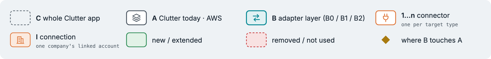
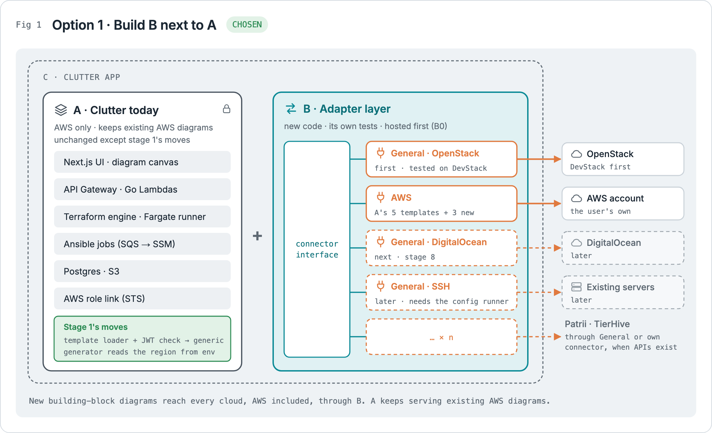
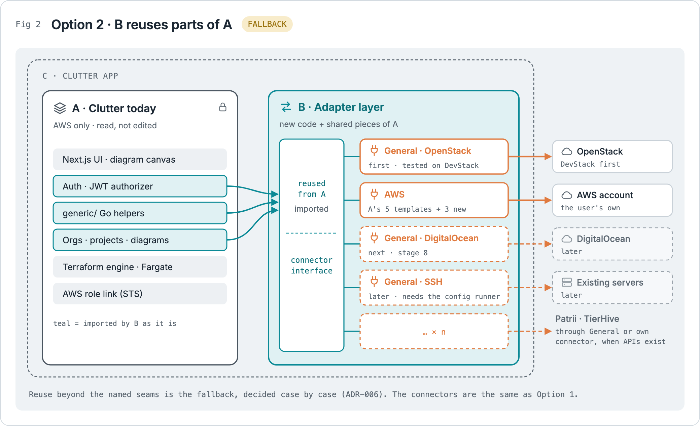
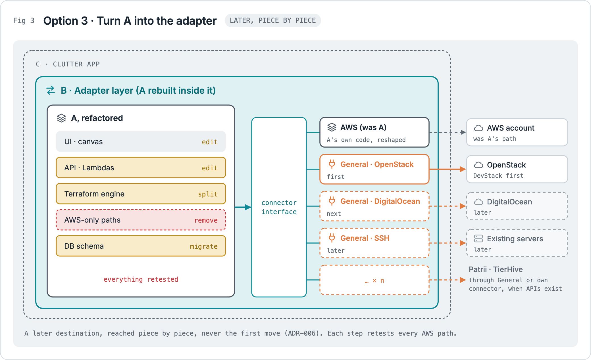
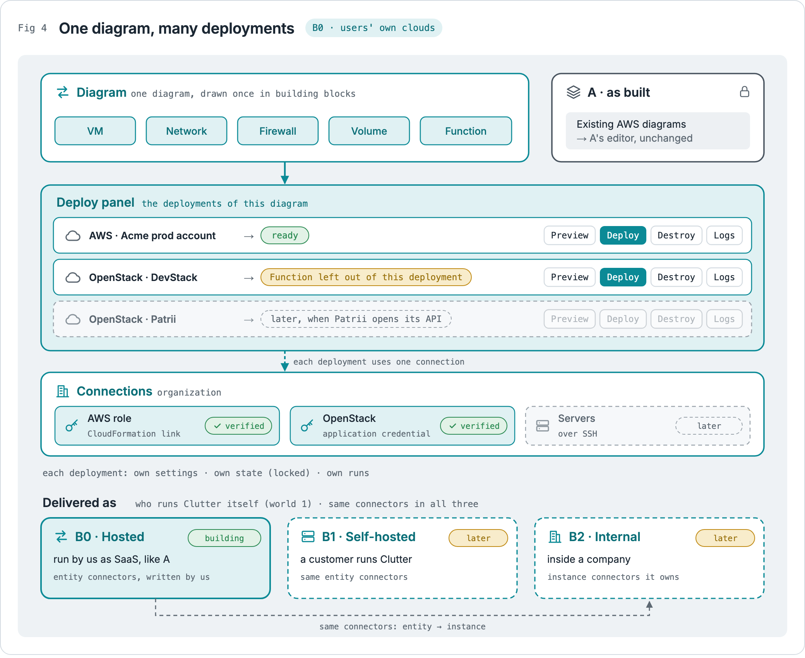
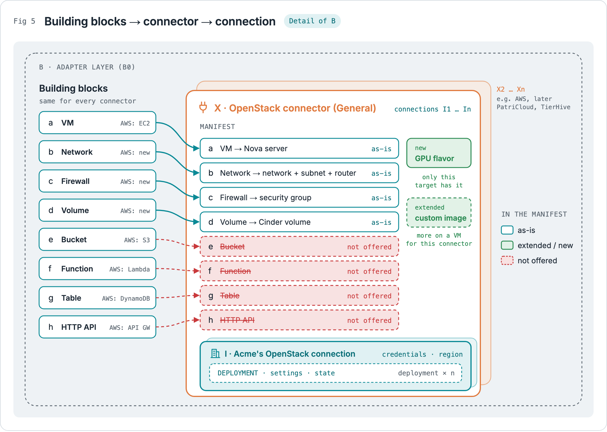
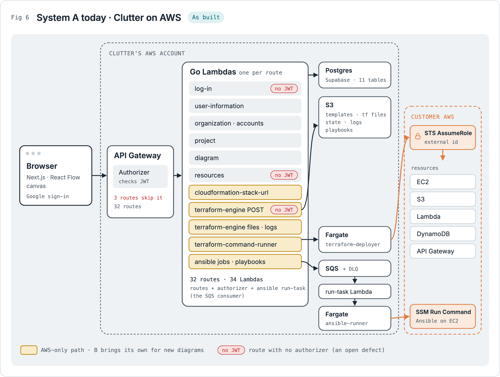
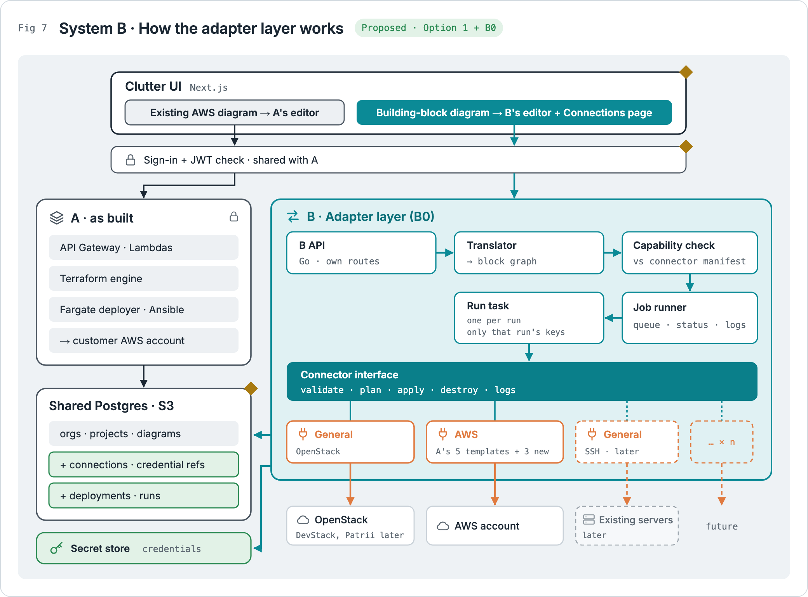
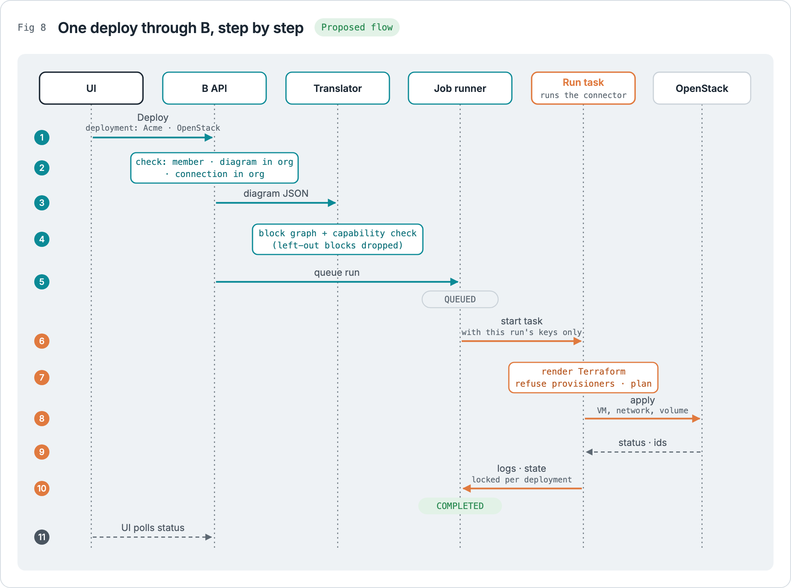
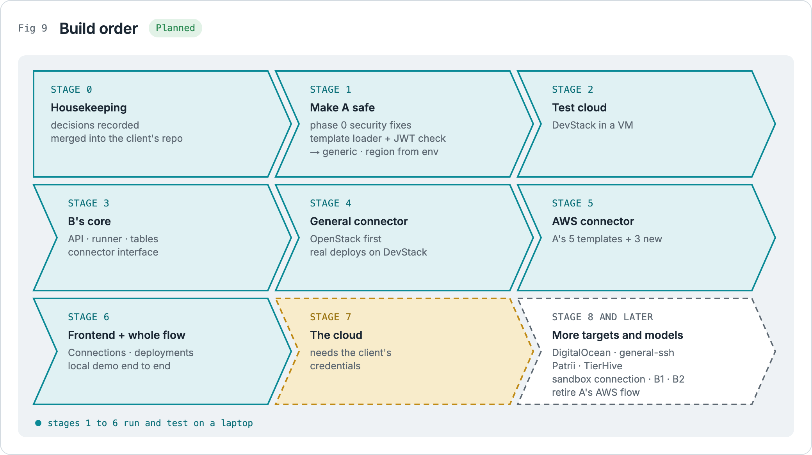

# The team's adapter-layer plan

The team's plan, first written on 2026-10-30 and updated on 2026-11-13 to match the decisions made since (ADR-013 to ADR-017): B0 first, users' own clouds, one diagram with many deployments, and the staged build order. The figures are in `figures/` (also bound together in `diagrams.pdf`). The design that owns the details is `docs/architecture/system-b-adapter-layer.md`; the overall picture is `docs/architecture/figures/clutter-worlds.png`.

## The context

**Clutter today** is a drag-and-drop canvas. A user places cloud resources on a diagram, Clutter turns that diagram into Terraform (plus Ansible for server setup) and deploys it into the user's own AWS account. It only works with AWS. It is built and tested, and today it runs locally (its AWS hosting was torn down).

**The goal** is to expand that same codebase so it can deploy to targets other than AWS. First General, which reaches many clouds through approved Terraform providers (OpenStack first), then AWS through B, then PatriCloud, TierHive and whatever comes later. You're doing this by building an **adapter layer**: one standard way for Clutter to talk to any target, with a separate **connector** for each target. The people who come after you should be able to add new connectors without reworking what already exists.

## The names

The names the figures use. Every name is defined once in `docs/architecture/system-b-adapter-layer.md` § Names.

- **C**: the whole Clutter app, the big outer box in every diagram.
- **A**: Clutter as it exists today. It is the AWS system and already a complete, tested application.
- **A2**: the local extension that runs A, and B beside it, on a laptop with no AWS.
- **B**: the adapter layer you're building.
- **1, 2, 3 … n**: **connectors**, one per target type (General's, one per approved Terraform provider with OpenStack first; AWS; then PatriCloud, TierHive and so on). There can be any number of them, and most new clouds arrive as General connectors.
- **B0**: the adapter run by us as a hosted service (SaaS). **Built first.**
- **B1**: the adapter shipped as a **self-hosted**, separate service that people can run and use. Later.
- **B2**: the adapter as an **internal** thing a company runs inside its own setup, not self-hosted by you. In B2 the connectors become **instance connectors**. Later, and a separate decision.
- **X**: a connector (X1, X2 … Xn).
- **I**: a **connection**, one company's linked account for a connector (I1, I2 … In).
- **Deployment**: one diagram bound to one connection. A diagram can have several.
- **a, b, c, d … n**: the **building blocks** the diagram is drawn in (VM, network, firewall, volume, bucket, function, table, HTTP API), which each connector maps onto.

## Level 1: three ways to attach B to A

### Fig 1 · Option 1: build B next to A (chosen)

A stays as it is, except stage 1's moves that make its template loader and JWT check shareable (ADR-006). B is a new, separate piece inside the same app that contains the connector interface, and connectors 1, 2, 3 … n plug into it.

The reason is testing. A is already a full working application. Changing anything in it means retesting and re-running it, so if you leave A alone, all of that stays safe. All new work and new tests live in B.

This split applies to both the backend (new services) and the frontend (new screens).

### Fig 2 · Option 2: B reuses parts of A (fallback)

The structure is the same as Option 1, but B reuses existing functions and code from A instead of rewriting them. That avoids copying or duplicating code and makes use of what already exists. How much gets reused depends on the code itself and how cleanly each part of A can be called from outside.

This is the fallback if Option 1 doesn't work out cleanly. The plan is to stay within Options 1 and 2.

From the repo: `backend/api/generic/` is the obvious candidate. It already holds shared Go helpers for responses, Postgres access, authorization and membership checks, and was written to be shared. Auth/JWT and the orgs, projects and diagrams data are also likely reuse points.

The trade-off: once B depends on parts of A, a change to those parts can break B. Those shared pieces need to be stable or have their own tests.

### Fig 3 · Option 3: turn A into the adapter (later, piece by piece)

This is what happens if you start from A and find that so much of it is nearly the same as what B needs that you convert A itself into the full adapter layer. That means editing A, removing AWS-only parts, splitting the Terraform engine and migrating the database. A gets absorbed into B, AWS becomes just one more connector, and B keeps expanding with the same connectors as the other options.

It is never the first move, because it means adjusting and retesting all existing functionality, including every AWS path, before any new connector ships. System A essentially *is* the AWS side of Clutter. It stays a later destination, reached piece by piece: once B's AWS connector covers what A's diagrams do, A's own AWS flow can retire (ADR-006).

## Level 2: inside B

### Fig 4 · One diagram, many deployments

This zooms into the overall system once B exists, as a user sees it.

- A diagram is drawn **once**, in building blocks.
- Each cloud it runs on is a **deployment**: the diagram, one **connection**, that cloud's settings, and its own Terraform state and runs. The deploy panel lists them, with a line saying whether each cloud can build everything ("ready"), or which block it leaves out.
- **Connections** belong to the organization and are linked once on the Connections page: an AWS role or an OpenStack application credential (servers over SSH later), each verified before it is saved.
- Diagrams made before B (AWS-only) keep opening in A's editor, unchanged.

There is no per-diagram "AWS or Custom" choice: deployments replace it. A diagram is not tied to one cloud, so the user never has to pick one up front.

B can be delivered three ways, and the same connectors serve all three:

- **B0, hosted adapter:** run by us as SaaS, like A. **Built first**, because it proves B with the least setup and support work.
- **B1, self-hosted adapter:** a separate service people run themselves, with access to everything Clutter offers. Its connectors (1, 2, 3, 4 … n) are **entity connectors**, one per target type, written by us. It stays possible because B accepts any Postgres and any S3-compatible store.
- **B2, internal adapter:** the same adapter used inside a company. Its connectors become **instance connectors**, because each company builds or configures its own.

The overall order of decisions is: choose among Options 1/2/3 (Option 1), then the delivery model (B0 first), and A stays as AWS either way (B's AWS connector reuses A's template files). Whether to do B2 at all is a separate decision: it needs information we do not have yet, namely how targets such as TierHive and PatriCloud work inside the companies that use them.

### Fig 5 · Building blocks → connector → connection

This goes one level further into B.

- **Building blocks** (a … h) are the same for every connector: VM, network, firewall, volume, bucket, function, table, HTTP API. They started from Clutter's real resource types on AWS today: compute VM (EC2), object storage (S3), serverless function (Lambda), table (DynamoDB), HTTP API (API Gateway), and the config runner (Ansible via SSM), which comes later because most non-AWS clouds have no SSM.
- **X** is a connector, here General's OpenStack connector. Its **manifest** says how it treats each block. There can be X2 … Xn: AWS, and later PatriCloud and TierHive.
- **I** is one connection for X: one company's OpenStack (or, later, one company's TierHive), with its own credentials and region. There can be I2 … In. Each **deployment** that uses it has its own settings and state; this replaces the first version's "workspace" inside an instance.

Each connector can treat each block differently:

- **As-is:** the block maps straight across (a VM becomes a Nova server, a network becomes a network, subnet and router).
- **Extended:** the block exists with more for this connector or connection (for example, later, a config runner plus a custom image).
- **Removed / not offered:** the block does not apply (OpenStack here has no function or bucket); a deployment can leave such a block out.
- **New:** something only this connector has, outside the standard set (a GPU flavor).

Shared behaviour lives in the building blocks. Differences live in the connector's manifest, never in the standard set.

## Level 3: how it actually works

### Fig 6 · System A today (as built)

From the repo and the final report:

1. The **browser** runs the Next.js and React Flow canvas, with Google sign-in.
2. **API Gateway** checks requests with a JWT authorizer Lambda, except three routes with no authorizer: `POST /log-in`, `GET /resources` and `POST /terraform-engine` (the last is phase 0 item 1).
3. **Go Lambdas** each handle one domain: log-in, organization and accounts, project, diagram, resources, terraform-engine, tf-command-runner, ansible jobs and cloudformation-url. That's 32 endpoints.
4. **Data:** Postgres (Supabase, 11 tables) and S3 (templates, .tf files, state, logs, playbooks).
5. **Deploy path:**
   - The **terraform-engine** reads the diagram JSON and fills Go templates from S3 to produce `main.tf` and `outputs.tf`, generating IAM policies from the diagram's edges.
   - The **tf-command-runner** starts a **Fargate terraform-deployer** task. That task assumes a role in the **customer's AWS account** (STS with an external ID, set up through a CloudFormation stack) and runs plan, apply or destroy.
   - **Ansible jobs** go through SQS (with a dead-letter queue) to the `ansible/run-task` Lambda, which starts a **Fargate ansible-runner** that uses SSM Run Command to configure EC2.

The amber parts in the diagram are the AWS-only path. B brings its own for new diagrams, on every cloud.

### Fig 7 · System B: how the adapter layer works (proposed)

This is how B works under Option 1, delivered as B0:

1. **Clutter UI:** existing AWS diagrams open in A's editor; building-block diagrams open in B's editor, with the Connections page and the deploy panel.
2. **Shared sign-in and JWT check:** reused from A, so users sign in once.
3. **A stays unchanged** on its AWS path, except stage 1's template, JWT and region moves.
4. **Inside B:**
   - **B API:** B's own Go service and routes.
   - **Translator:** turns the diagram into a graph of building blocks.
   - **Capability check:** compares the graph with each connection's connector manifest and flags what it cannot build.
   - **Job runner:** queues each run and tracks status and logs.
   - **Run task:** one short-lived task per run, holding only that run's keys.
   - **Connector interface:** one contract every connector implements: validate, plan, apply, destroy, logs.
   - **Connectors:** General's (OpenStack first, then more approved providers, then existing servers over SSH), AWS (reusing A's 5 templates plus 3 new ones), then PatriCloud, TierHive and future targets, through General where they offer a standard provider.
5. **Shared Postgres and S3:** existing orgs, projects and diagrams, plus new tables for connections, credential references, deployments and runs. Credentials themselves sit in a secret store.

The gold diamonds mark the **places B touches A**: the UI, shared sign-in, and the shared database. The fourth seam is the security fixes on paths B shares with A. Even in Option 1, these are the unavoidable connection points.

### Fig 8 · One deploy through B, step by step

1. The user clicks Deploy on one deployment (for example Acme's OpenStack).
2. B API checks that the user is a member, the diagram is in that organization, and the connection is too.
3. B API sends the diagram JSON to the translator.
4. The translator builds the block graph and runs the capability check; blocks left out of this deployment are dropped.
5. B API queues the run (status QUEUED).
6. The job runner starts a run task with only this run's keys.
7. The task renders the Terraform, refuses anything unsafe, and plans.
8. It applies on OpenStack, creating the VM, network and volume.
9. OpenStack returns status and resource IDs.
10. The task returns logs and state (locked per deployment) to the job runner (status COMPLETED).
11. The UI polls for status, as A does today.

### Fig 9 · Build order (planned)

0. **Stage 0:** housekeeping: decisions recorded, the design checked, questions sent to the client.
1. **Stage 1:** make A safe (security fixes, and A's template code made shareable).
2. **Stage 2:** a test cloud on a laptop (DevStack).
3. **Stage 3:** B's core: API, runner, connector interface.
4. **Stage 4:** General's OpenStack connector, with real deploys on DevStack.
5. **Stage 5:** the AWS connector, reusing A's templates plus 3 new ones.
6. **Stage 6:** the frontend and the whole flow: B's editor, Connections page and deployments.
7. **Stage 7:** the cloud, once the client's accounts arrive.
8. **Stage 8 and later:** more General connectors (DigitalOcean next, then existing servers over SSH), PatriCloud and TierHive (once they have APIs), the optional Clutter sandbox connection, B1, then B2 with instance connectors once partner details exist, and moving AWS fully into B piece by piece, which reaches Option 3's clean end state without a big-bang retest.

Stages 1 to 6 run and are tested on a laptop. The details of each stage are in `docs/architecture/implementation-plan.md`.

## Assessment and recommendations

Overall the plan is sound. The figures form a clear chain:

- how B attaches to A (Option 1 preferred, 2 as fallback, 3 avoided)
- how users deploy (one diagram, many deployments; B0 now, B1 and B2 later, A kept for existing AWS diagrams)
- how features map onto connectors and connections

Things to settle before coding:

1. **"Don't touch A" really means "touch A only at the seams."** Shared sign-in, the frontend's Connections page and deploy panel, and new tables for connections and deployments are unavoidable. Name them up front so Option 1 doesn't drift into Option 2 without anyone deciding it.
2. **Define the connector interface first.** Something like validate → plan → apply → destroy → logs, mirroring what A's Terraform runner already does. Every connector, and B2 later, implements the same contract.
3. **The diagram engine is the hardest part.** A's Terraform engine is built around AWS resources and IAM rules. Each connector needs its own mapping from the same diagram. Decide early whether connectors output Terraform for other providers, call target APIs directly, or both.
4. **Make connectors declare their capabilities.** Each connector lists which features it supports, extends or drops (Fig 5's as-is / extended / removed / new). The UI can then hide what a target can't do instead of failing at deploy time.
5. **Pin down entity vs instance connectors.**
   - An *entity connector* is a kind of cloud, like OpenStack or TierHive, written once by us.
   - A *connection* is one company's configured setup of it.
   - In B0 and B1, a connection is configuration (credentials, region).
   - In B2, connections become code each company owns: *instance connectors*.
6. **Keep Option 3 as a possible destination, not the starting move.** If B's interface is general enough for AWS to fit, A can migrate into it gradually, whenever that's worth it.

## Open questions

- How do TierHive and PatriCloud expose their infrastructure (Terraform providers, APIs, something else)? This decides how connectors are built and whether B2 is realistic.
- What does "General / custom" mean concretely? Plain Terraform for any provider, or a generic API format?
- Does B1 run as Lambdas like A, or as a long-running container, given that self-hosters need to run it outside your AWS account?
- Where are connector credentials stored, and how are they secured for each connection?

Answers so far: TierHive and PatriCloud have no public API yet (`docs/research/`); General is a family of connectors, one per approved Terraform provider (OpenStack first), plus existing servers over SSH, and it is where new clouds are added (ADR-008, ADR-017); B runs as a container (ADR-004); credentials are borrowed roles or encrypted secrets with only a reference in Postgres (ADR-016). Details are in `docs/architecture/system-b-adapter-layer.md`, and what is still open is in `.claude/findings/NOW.md`.
